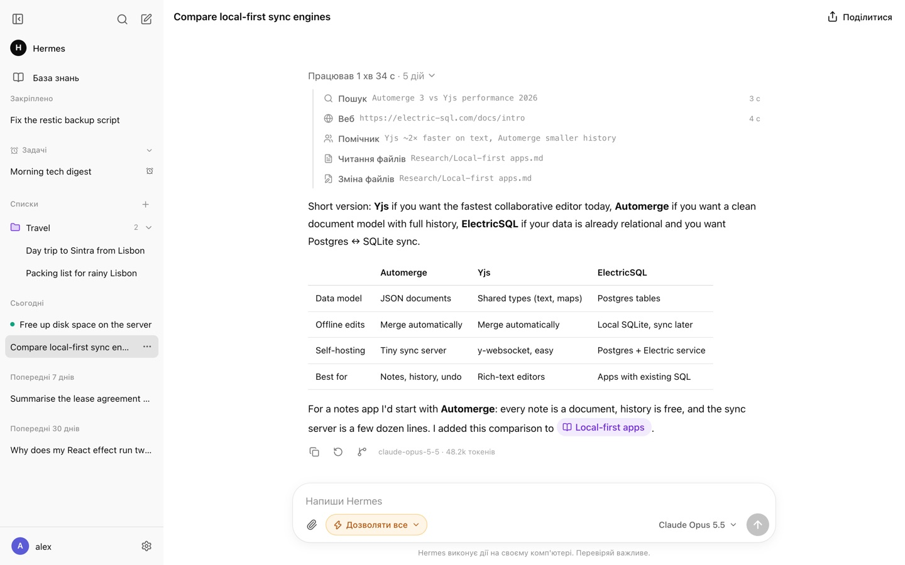
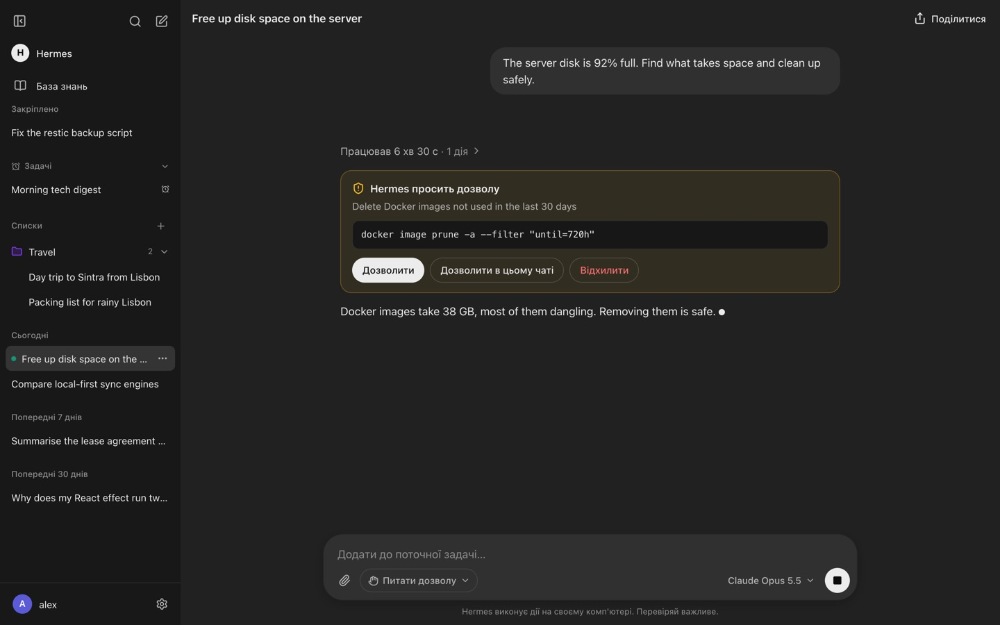
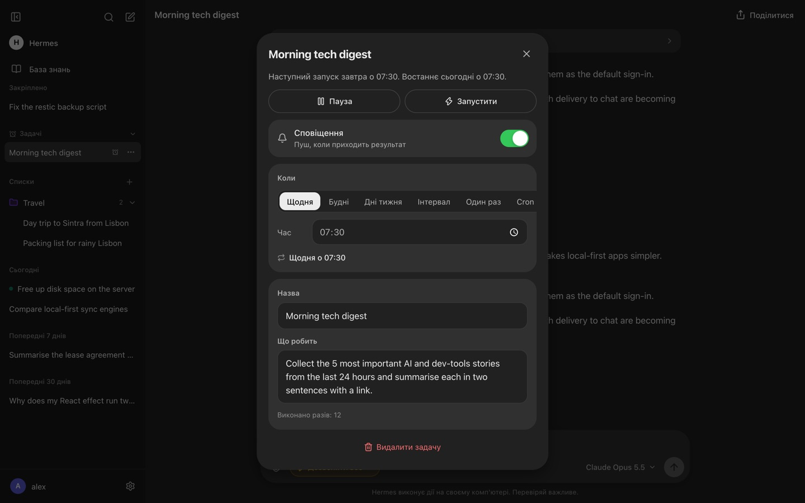
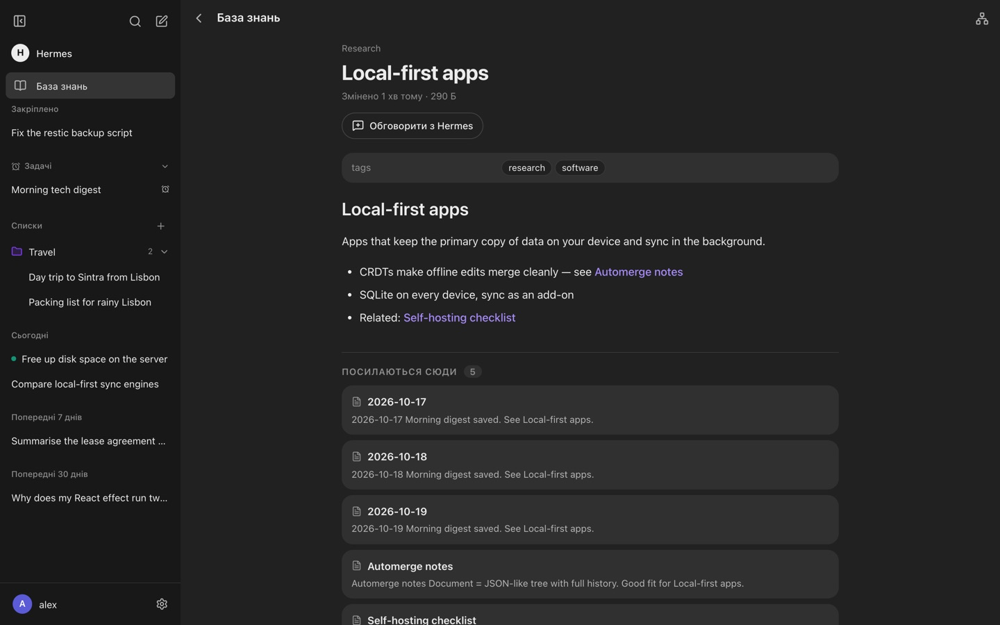
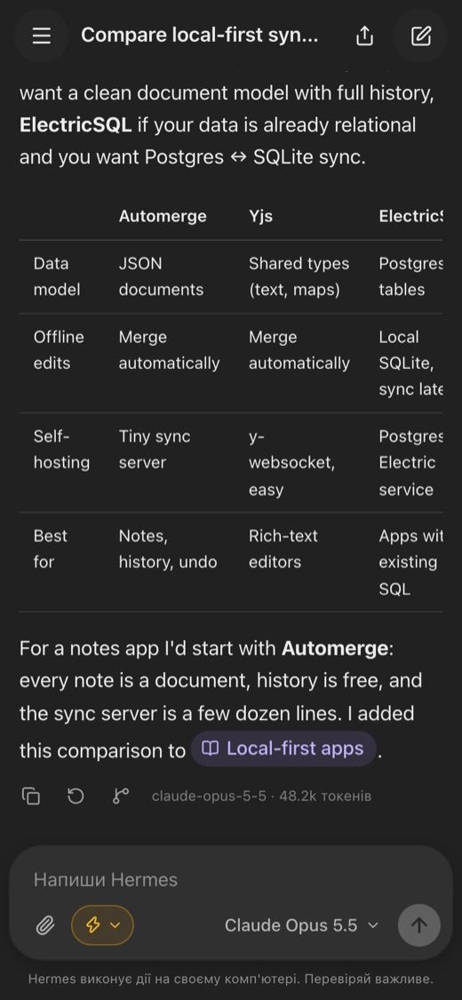

# Hermes Chat

**Власний веб-чат у стилі ChatGPT, зроблений спеціально для [Hermes Agent](https://hermes-agent.nousresearch.com).**
Чат говорить із Hermes його рідним протоколом gateway, тому показує роботу агента наживо: інструменти, помічників,
запити на дозвіл. Тут же — задачі за розкладом, база знань Obsidian, куди пише Hermes, і пуші на телефон.
Один користувач, твій комп'ютер, без хмари.

[English](README.md) · [Архітектура](docs/ARCHITECTURE.md) · [Безпека](SECURITY.md) · [Зміни](CHANGELOG.md)



## Що вміє

- **Хід роботи наживо.** Відповідь стрімиться, а поруч видно кожен крок Hermes: пошук, правки файлів, команди
  терміналу, помічники, тривалість. Коли відповідь готова, кроки згортаються в «Працював 1 хв · 5 дій».
- **Запити на дозвіл і уточнення** приходять картками з кнопками. Режим на кожен чат: питати дозволу,
  дозволяти все або лише план.
- **Доповнити, зупинити, повторити, редагувати, відгалузити.** Можна дописати до задачі, що триває, перемотати
  й переписати старе повідомлення або почати нову гілку з будь-якої відповіді.
- **Слеш-команди й навички** (`/goal`, `/plan`, `/loop`, твої навички) і панель мети для довгих цілей.
- **Задачі за розкладом.** Задача може писати в свій чат; під назвою чату видно, коли наступний запуск,
  а в шторці можна змінити час, поставити на паузу чи вимкнути сповіщення. Або просто попросити Hermes у чаті.
- **База знань Obsidian.** Вікі-посилання, зворотні посилання, пошук, граф зв'язків; нотатки, згадані у відповідях,
  стають картками. Оновлюється наживо.
- **Файли в обидва боки.** Картинки й документи від тебе; файли від Hermes (`MEDIA:/шлях`) — програвачі, прев'ю,
  картки завантаження. Великі файли не копіюються: тимчасове посилання на оригінал.
- **Картки посилань, YouTube у чаті, посилання «лише перегляд»**, експорт у Markdown, списки чатів.
- **Застосунок на Початковому екрані з пушами** (і на iPhone): відповіді, запити на дозвіл, результати задач.
- **Ключі доступу** (Face ID, Touch ID, YubiKey), список входів із виходом на інших пристроях, пароль із лімітами.

| Запит на дозвіл | Задача у своєму чаті | База знань | Телефон |
|---|---|---|---|
|  |  |  |  |

## Що потрібно

- **macOS або Linux**, той самий комп'ютер, де працює Hermes Agent.
- **Node.js 22.18+** (сервер — TypeScript, який Node виконує без збирання).
- **Hermes Agent 0.22+** із запущеним gateway (`hermes gateway start`) і API-сервером (`API_SERVER_KEY`
  у `~/.hermes/.env`). Ключ чат бере звідти сам.
- Для телефона — домен з HTTPS перед чатом (Cloudflare Tunnel, Caddy, nginx…).

Протокол gateway Hermes ще не є стабільним публічним API. У кожному релізі вказано, з якою версією Hermes
його перевірено, а `npm run doctor` попереджає, якщо твій Hermes старіший.

## Встановлення

```sh
git clone https://github.com/<you>/hermes-chat.git && cd hermes-chat
npm ci
npm run setup      # config.yaml з випадковим паролем (покаже один раз) і .env з прикладу
npm run build
npm run doctor     # перевірить Node, Hermes, gateway, міст і підкаже, що виправити
npm start          # http://localhost:5190
```

Увійди з показаним паролем, відкрий **Налаштування → Обліковий запис → Вхід і безпека**, додай ключ доступу
й вимкни вхід за паролем.

### Доступ з телефона

Сервер слухає лише `127.0.0.1`. Назовні його виводить проксі з HTTPS, а в `.env` треба вказати домен:

```sh
# .env
PUBLIC_HOST=chat.example.com
```

Найпростіше — **Cloudflare Tunnel** (без відкритих портів і білої IP):

```sh
cloudflared tunnel login
cloudflared tunnel create hermes-chat
cloudflared tunnel route dns hermes-chat chat.example.com
cloudflared tunnel run --url http://127.0.0.1:5190 hermes-chat
```

Або будь-який зворотний проксі, наприклад Caddy: `chat.example.com { reverse_proxy 127.0.0.1:5190 }`.
Ключі доступу прив'язані до домену: після зміни `PUBLIC_HOST` їх треба додати заново.
На iPhone пуші працюють лише в застосунку з Початкового екрана (Поділитися → На Початковий екран).

### Запуск як служба

Приклади для launchd (macOS) і systemd (Linux) — в [англійському README](README.md#run-as-a-service),
вони однакові.

### Hermes пише в чат (необов'язково)

Щоб результати задач за розкладом і `send_message` приходили в чат, постав плагін:

```sh
npm run setup:hermes        # чат має бути хоч раз запущений: він створює ключ
hermes gateway restart      # коли Hermes нічого не робить
hermes send -t webchat:Тест "привіт"
```

Докладніше — [`hermes-plugin/README.md`](hermes-plugin/README.md).

### База знань Obsidian (необов'язково)

Чат показує сховище з `OBSIDIAN_VAULT_PATH` у `.env` Hermes (або `VAULT_PATH` у `.env` чату). На macOS служба
не має доступу до iCloud Drive, тож для сховища в iCloud постав дзеркало: `npm run setup:vault-mirror`
(копія в `data/vault/`).

### Часовий пояс розкладу

Hermes рахує розклад у поясі з `timezone:` у `~/.hermes/config.yaml`. Якщо там порожньо, після переходу
на літній чи зимовий час задачі зсуваються на годину. Задай пояс, наприклад `timezone: Europe/Kyiv`;
`npm run doctor` це перевіряє.

## Налаштування (`.env`)

Повна таблиця — в [англійському README](README.md#configuration-env); кожна змінна пояснена в `.env.example`.
Найважливіші: `PUBLIC_HOST` (домен чату), `HERMES_HOME` (тека Hermes), `DATA_DIR` (дані чату),
`VAULT_PATH` (сховище Obsidian).

`config.yaml` — логін і пароль єдиного користувача (створює `npm run setup`). Файл перечитується, коли змінився;
зміна пароля розлогінює всі пристрої. `allow_password: true` вмикає вхід за паролем, якщо загубиш усі ключі.

## Оновлення

```sh
git pull && npm ci && npm run build   # потім перезапусти службу
```

Міграції бази виконуються самі при старті. Перед оновленням глянь [CHANGELOG.md](CHANGELOG.md).

## Резервні копії

Усе лежить у `data/`: `chat.db` (чати й повідомлення), `uploads/` (файли), ключі (`.session-secret`,
`.vapid.json`, `.hermes-hook-token`). Зупини чат і скопіюй теку або зроби копію бази наживо:
`sqlite3 data/chat.db ".backup backup.db"`. Історію розмов Hermes також зберігає у себе.

## Розробка

```sh
npm ci
npm run dev        # сервер + Vite з гарячим оновленням, http://127.0.0.1:5190
npm run check      # типи, лінтер, тести й збірка
```

Див. [CONTRIBUTING.md](CONTRIBUTING.md) і [docs/ARCHITECTURE.md](docs/ARCHITECTURE.md).

## Обмеження

- Користувач один — так задумано.
- Розмови з Telegram чи термінала тут не видно: чат бачить лише свої сесії Hermes.
- Hermes чекає відповіді на запит дозволу `approvals.timeout` секунд (`~/.hermes/config.yaml`), потім вважає
  його відхиленим. Це спільне налаштування для всіх каналів Hermes.

## Ліцензія

[MIT](LICENSE). Hermes Chat — незалежний проєкт, не пов'язаний із Nous Research.
